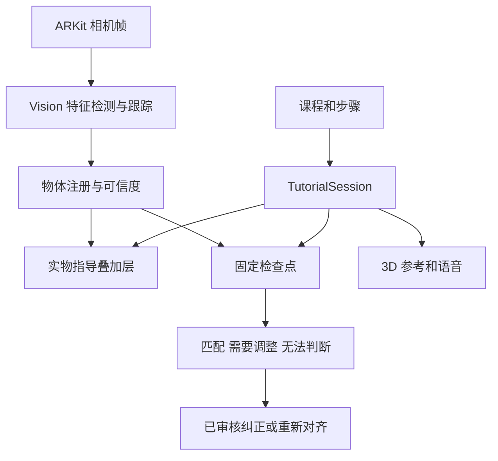

# Protacta 创业 App 构建计划

Protacta 将复用 Foliafold 已有的原生 3D 教程、桌面 AR、英语免手操作和本地进度，增加贴合真实物体的指导、固定检查点的计算机视觉检查，以及与当前步骤对应的纠正帮助。第一版完成一套经实际跟折验证的 origami 教程；之后再扩展到衣物、床单、毛巾、绳结和领带。

计划日期：2026 年 10 月 25 日。产品目标是让用户看清“操作哪里、往哪个方向、到什么位置”，并在卡住时得到具体帮助。

这是制定计划时的范围与基线记录。后续工程实现和验证状态见 [PROGRESS.md](PROGRESS.md)；下列目标、时间段与技术候选不代表已经通过真机或学习效果验收。

## 产品范围和交付层次

沿用报告的 MVP 范围：一套完整支持的 origami 教程，包含实物对齐指导和预设步骤的相机检查。任意物体识别、全过程三维形变跟踪、隐藏纸层判断和自由生成折叠动作不进入这一版。

| 层次 | 交付内容 | 完成条件 |
| --- | --- | --- |
| 技术验证 | 一张平纸和一个动作的对齐闭环 | 移动后跟随，失效时隐藏，重新可见后恢复 |
| 完整课程试用版 | 从材料准备到成品的完整教学流程 | 每一步有可操作的指导；明确哪些步骤支持实物叠加与相机检查 |
| 创业 MVP | 一门完整课程，加实物指导、固定检查、纠正帮助、进度和测试结果 | 受支持检查点经过独立样本验证，初学者能够完成整套流程 |

第一折演示不能代替完整课程 MVP。三课程内容包和其他生活技能属于后续扩展。礼物包装与 3D paper arts 继续保留为团队待定范围。

## 现有 App 的复用基础

当前开发源码为 Foliafold 1.0.1 Build 11，包含 12 个课程、2 个免费课程和 13 类英语语音命令。Build 11 增加了直接 Hands-free 入口、Restart lesson 和有次数限制的语音恢复。语音是固定命令与作者说明朗读，不是自由问答。

| 模块 | 可以复用 | Protacta 需要补充 |
| --- | --- | --- |
| 教程播放 | 旋转、缩放、暂停、慢放、重播和步骤控制 | 将教程步骤与实物检查点关联 |
| RealityKit 和 ARKit | 3D 渲染、相机、桌面摆放、遮挡与中断处理 | 真实纸张的位置匹配和提示叠加 |
| 语音与帮助 | 13 类命令、朗读、I’m stuck 和现有帮助面板 | 新课程专属帮助；检查结果对应的解释 |
| 学习进度 | 本地存档、课程修订后使旧存档失效 | 区分用户确认、视觉检查与动画播放进度 |
| StoreKit 2 | 购买验签和权限处理的代码结构 | 按最终 App 身份与收费范围配置权益 |

真实纸张注册、Vision 或 Core ML 检查模块、生成式 AI 服务和应用后端尚未集成。已有深度遮挡只解决前后遮挡关系，不提供折痕理解。

开发阶段保留 Foliafold 的产品身份与发行工程，用隔离的 Protacta 开发配置或 target 验证新能力。最终是沿用原 App 还是独立发行，由团队在发布前决定；购买项目、用户权益和签名不能随产品改名直接搬用。

## 用户的完整操作流程

1. 选择课程，查看成品、难度、材料尺寸和预计步骤；第一版界面、教程和语音继续使用英语。
2. 先在 3D 中查看动作，或进入 Guide on my object。相机模式提示固定手机、放平材料和确认朝向。
3. 检测支持的物体状态，完成位置、角度和大小的匹配；对齐成功后显示折线、目标边和动作箭头。
4. 用户查看当前动作后实际操作。语音支持 Next step、Previous step、Show me again、Slower 等已有命令，按钮始终可用。
5. 到预设位置后点 Check my step。相机根据当前课程和步骤检查可见特征，返回“可见部分符合检查项”“需要调整”或“无法判断”。
6. 需要调整时，高亮有关边或角，显示一句短解释，并提供对应重播。看不清时要求换角度或重新放平，保留 I’m stuck 帮助。
7. 抬起、翻面、遮挡或中断后重新对齐。继续学习只恢复教学步骤，不恢复上次相机位置。
8. 用户确认完成作品，保存进度并反馈卡住的位置。用户确认完成与系统视觉检查结果分别记录。

用户说 Next step 只代表请求播放或进入下一步，不能自动证明真实操作正确。首版的 Check my step 先使用按钮入口；若增加语音检查命令，需要另外实现命令路由和测试。

## 界面和模块

首页保留清楚的继续学习入口；课程页展示材料、成品和步骤；教学页集中呈现当前动作、3D 参考、语音状态、检查和求助。完成页保存学习记录与反馈，避免先加入账号、社区或复杂成就系统。

实物指导需要可见的状态：寻找物体、已对齐、暂时失去对应关系、重新对齐和当前状态不支持。用户应知道现在是否可以相信叠加提示。

建议在代码中逐步形成 TutorialSession、LessonCatalog、GuideRenderer、ObjectTracker、Registration、CheckpointEvaluator、FeedbackResolver、VoiceGuide 和 ProgressStore。首个实现仍可使用 PaperVisionTracker、PaperRegistration 等纸张专用模块，通过接口与通用教学流程连接；不提前构建支持所有物体的检测器。

## 技术架构

保留一个 ARSession，复用现有相机帧入口。视觉检测在独立串行工作任务中运行，最多一帧在途；每个结果携带会话、步骤、时间戳、方向和视口信息，过期结果不能覆盖新状态。

新模式区分 studio、tabletopModel 和 alignedObject。AR 世界追踪正常不等于纸张匹配成功，不能直接放松现有桌面锚点的保护条件。

第一轮在相机画面上绘制经过审阅的二维折线、箭头和目标轮廓，避免不透明虚拟纸遮住真实操作物。半透明动作预览放到定位稳定之后；它表示预期动作，不表示已经跟踪真实纸层的三维变形。

MVP 采用本地课程、进度和端上视觉处理，不把云服务作为启动依赖。需要模型时评估 Core ML；自由问答和云端内容管理在核心流程通过验证后另行设计。

## 课程和检查点数据

教学动画、实物定位和操作判断使用独立状态。现有动画 progress 不能充当真实完成度。

| 数据 | 主要字段和作用 |
| --- | --- |
| Tutorial | 稳定 ID、类别、材料要求、内容版本、步骤和渲染适配器 |
| Step | 稳定 ID、说明、解释、动作提示、前后步骤和帮助内容 |
| AlignmentCheckpoint | 所属步骤、支持面、参考轮廓、带身份的特征点、方向参考、提示几何与可见性条件 |
| PaperObservation | 会话、时间戳、方向、特征点、可见性和匹配质量 |
| CheckResult | 检查点、可见依据、结果类别、错误类别、已审核纠正与无法判断原因 |
| LearningProgress | 教程版本、教学步骤、用户确认和检查记录；不保存可直接恢复的相机配准 |

每一步建立覆盖表：起始状态、动作、结束状态、支持视角、对齐方法、检查项、典型错误和恢复方式。新增其他类别时分别补充对象状态与渲染适配器，不把衣物或绳结强行塞进固定折纸枚举。

课程文字可逐步数据化，但现有几何和动画仍由 Swift 实现。新增一个模型不等于上传一份 JSON，内容生产必须包含动作、几何、提示和真人跟做审阅。

## 自动对齐和视觉检查的实现路线

第一步用 Classic Dart 的平放 A4 纸和中心折线验证自动对齐。Apple Vision 的矩形检测与跟踪可作为平纸的候选入口；四角对应和方向参考用于计算纸面到画面的映射。[Apple 矩形检测](https://developer.apple.com/documentation/vision/vndetectrectanglesrequest)、[Apple 跟踪示例](https://developer.apple.com/documentation/Vision/tracking-multiple-objects-or-rectangles-in-video)

对称纸张可能有朝向歧义。先验证自然特征，不稳定时使用非对称练习纸标记或一次方向确认。标记必须随纸移动，并在相应检查点可见；桌面标记不能证明独立移动的纸张已经对齐。

平面映射只用于近似共面的支持状态。折后形状需要各自的轮廓和特征匹配，不能把所有阶段都当作矩形。纸层举起、变形或对应关系失效时隐藏叠加提示，继续提供 3D 参考。[平面映射原理](https://docs.opencv.org/4.x/d9/dab/tutorial_homography.html)

首批候选检查点是平纸或展开状态、左上角折平、两个上角折平；通过后再评估收窄两侧。平纸与重新展开的外轮廓相同，不能仅凭轮廓批准中心折痕已完成。

完整课程优先沿用 Classic Dart。Little Fox 可作为团队评估的备选，它的课程较短、许多状态可放平，但仍需处理对称、折痕与翻面问题。课程选择应由真实样纸的可见性和错误样例验证决定。

视觉检查先比较轮廓、边、角和可见折线与当前检查点的关系。几何方法不足时，再用收集的数据评估 Core ML 模型。三种结果始终分开：可见匹配、可能错误、无法判断；定位置信度不能代替操作正确率。

第一版纠正来自作者审阅的规则与说明。后期增加生成式 AI 时，只让它解释当前步骤和已确认的可见证据，不让它补造隐藏纸层或新折法。

## 建议排期

以下是从 10 月 26 日开始、保留报告 12 月 2 日最终交付目标的重排草案。报告原定 11 月 1 日完成试点课程；按当前仍缺实物视觉模块的情况，这个目标需要团队依据首轮结果重新确认。

| 时间 | 主要交付 | 验收门槛 |
| --- | --- | --- |
| 10 月 26 日至 11 月 1 日 | 保存版本基线，复用完整课程流程，完成第一折自动对齐技术闭环 | 实物提示跟随移动，失效隐藏，重新可见后恢复；明确演示覆盖范围 |
| 11 月 2 日至 11 月 8 日 | 审阅完整课程，扩展支持检查点，收集正确和错误样本 | 每一步都有指导与恢复方式；检查点和错误标签固定 |
| 11 月 9 日至 11 月 15 日 | 集成三类检查结果、已审核纠正、求助与进度，冻结单课程 MVP 候选版 | 从准备材料到成品全程走通；留出样本和无法判断处理有效 |
| 11 月 16 日至 11 月 22 日 | 真机回归和约 10 位初学者的探索性试验 | 记录对齐、检查、完成、错误、求助和退出位置 |
| 11 月 23 日至 12 月 2 日 | 修复高频问题，整理演示、结果和下一版范围 | 可重复演示，有明确设备条件、覆盖范围和失败处理 |

视觉数据和算法验证可能改变工期。检查点减少可以作为阶段性试验收缩，但只有一折演示时仍按技术验证交付，不能改称完整 MVP。

## 团队分工

沿用报告中的角色，将工程任务具体化；每周投入和每个任务的实际负责人由团队认领。

| 成员 | 主要工作 | 交付 |
| --- | --- | --- |
| Chenyu Qiu | 原生 App、教学状态、渲染、配准集成、语音和进度、构建与回归 | 可运行的课程与实物指导流程 |
| Imron Barotov | CV 方法比较、数据标注规则、检查模型与评估、几何和识别约束 | 支持状态、检查结果及错误分析 |
| Hana Mostafa | 界面、用户流程、研究、初学者任务与体验反馈 | 原型流程、可用性问题和迭代建议 |
| Shaikha Al-Emadi | 市场和商业模型、定价研究、招募与产品表达协作 | 市场反馈、试点招募与商业假设 |

真实样纸审阅、常见错误收集和 MVP 验收由全员参与。

## 验收和测试

对齐误差使用独立标注点或折线测量，不能只用参与求解的四角自评。调参与测试按物理纸张、操作者和拍摄场次划分，避免相邻视频帧混入两组。

| 领域 | 记录什么 | 通过标准的用途 |
| --- | --- | --- |
| 定位和恢复 | 归一化误差、抖动、有效提示覆盖率、失效时错误显示、恢复时间 | 纸宽 3% 误差与可见后 1 秒恢复是待验证的工程目标 |
| 视觉检查 | 正确、错误、无法判断的混淆情况，尤其是错误被批准的比例 | 在留出数据上报告样本数和结果，决定哪些检查点可以开放 |
| 语音和状态 | 下一步、上一步、重播、重新开始、朗读互扰、中断和过期回调 | 真机重复命令正确执行，按钮备用可用，不把语音当作完成证明 |
| 完整课程 | 准备、每步操作、检查、求助、恢复、继续和完成 | 全程无死路；支持范围外仍有清楚的操作路径 |
| 初学者体验 | 完成、用时、错误、求助、退出和看不懂的位置 | 与匹配难度的常规教程比较并改变任务顺序，指导下一轮修改 |

约 10 人试验用于发现问题与形成初步趋势，不预先写学习提升百分比。代码数学测试、模拟器流程和真机体验分别记录；候选版本地构建不能代替现场语音或相机验收。

## 首个迭代任务

- [ ] 保存当前源码和资源，建立可回退的版本基线；当前工程根目录尚无 Git。
- [ ] 审阅一张真实 A4 纸的方向、四角身份、中心折线和移动箭头。
- [ ] 定义 AlignmentCheckpoint、Observation、RegistrationResult 与独立的对齐状态。
- [ ] 实现并测试平面映射、纵横屏、图像方向、裁剪和错误对应点处理。
- [ ] 从单一 ARSession 向后台视觉任务提供帧，丢弃过期或步骤不一致的结果。
- [ ] 加入 Guide on my object 模式和叠加层；保留现有 3D 与桌面 AR。
- [ ] 加入失效隐藏、重新对齐和标记练习纸备用方案。
- [ ] 在真实手机和独立样本上记录第一折闭环，再确定全课程的检查点覆盖表。

第一轮最清楚的交付是：真实纸张在相机中移动时，中心折线和方向提示跟随；纸张离开支持状态时提示隐藏，再放平后恢复。

## 代码入口和参考资料

代码复用入口：LessonController.swift 的相机帧与教学控制、PaperStepsApp.swift 的教学视口、PaperGeometry.swift 与 PaperModel.swift 的几何及渲染、VoiceGuide.swift 与 VoiceRecoveryPolicy.swift 的免手操作、LearningProgressStore.swift 的版本化进度、FoldHelp.swift 的作者帮助。

新增 Swift 或资源文件后，通过 scripts/generate_xcode_project.py 更新 Foliafold 工程。旧 PaperSteps.xcodeproj 不作为发行工程。

产品范围与分工依据：[Protacta 项目报告](https://docs.google.com/document/d/1hRcgI5_5_9sqvR-D4NNKAIgxVK1m7aAJ3mMD_AZs5tM/edit?tab=t.0)。展示与技术方向依据：[Tech report](https://docs.google.com/document/d/15MZZbIHWGUBORvwtYalR_venHczOmWLXDdQa0VVY-e0/edit?tab=t.nf28me279i2m)。当前候选版说明：origami_ar_demo/docs/HANDSFREE_BUILD_11.md。

发布前需要确定：首门完整课程、检查点覆盖、是否使用练习纸标记、App 身份与收费范围、每周团队投入。课程数量和语音命令数量只描述已有功能，不代表实物对齐或教学效果已经验收。

