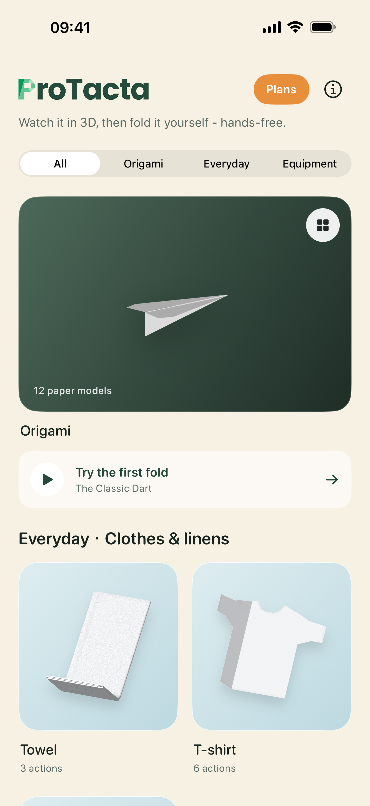
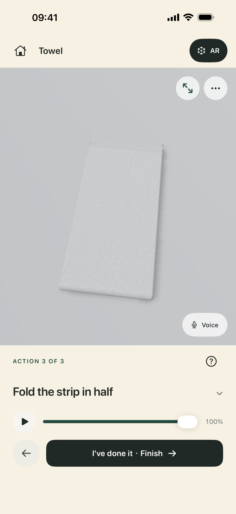

# Imron UX and Build 37 model integration

This candidate keeps Imron's latest home experience and branding while bringing forward the latest everyday 3D lessons from the local Build 37 working tree. It is prepared on the local `integration/imron-ux-build38` branch for prototype Build 38.

- **Upstream base:** `b58efaf7249af9dfe68e087dc6eb072ef929cd32`, including Imron's home/playback refresh (`31ecd9f`) and ProTacta wordmark update (`b58efaf`).
- **Model source:** the Build 37 working tree at `/Users/adrian/Desktop/QCRI/protacta_app`, rather than its older committed HEAD alone.
- **Integration checkout:** `/Users/adrian/Desktop/QCRI/protacta_ux_model_integration`. The original checkout and its local work are preserved.

## Retained behavior

Imron's home organization, branding, recent-practice support, and concise playback labels remain the UX baseline. His app icon, logo mark, and wordmark assets are retained.

The five everyday courses—Towel, T-shirt, Flat bedsheet, Square knot, and Four-in-hand necktie—use the latest authored geometry and continuous motion. Playback supports scrubbing, pausing, replaying, and changing speed. A completed animation does not confirm that the learner completed a physical action.

The towel, T-shirt, and bedsheet retain white terry, jersey, and linen materials with scanned PBR maps and attribution. Latest improvements include stable surface UVs, cloth thickness and hems, rounded towel folds, knot/ribbon orientation, current-step framing, and enlarged focus on folded poses. Studio floor/shadow corrections remain confined to the studio view. These are authored folding animations, not a general cloth-physics simulation.

Classic Dart retains its draggable progress slider and the before/after comparison for steps 7 and 8.

Imron's 0.5× / 1× / 2× controls and Auto-play remain available. Speed now survives a restart, with backward-compatible reads of older slow-motion records. Auto-play stops at the final animation endpoint and requires an explicit Finish; pausing, scrubbing, navigating, backgrounding, or interrupted AR tracking cancels pending automatic advancement. The home shortcut opens the first Dart fold paused, and Resume opens the saved pose directly.

## Source mapping

| Area | Integration decision |
| --- | --- |
| Home and player UI | Retain Imron's `ProtactaHomeView`, root/player presentation, branding, and shorter playback labels while connecting the latest lesson behavior. |
| Everyday models and rendering | Retain Build 37 geometry, material, animation, framing, object-guide, and AR implementation. |
| Shared knot geometry | Retain Build 37 geometry plus Imron's two algebraically equivalent typed-expression refactors. |
| Recent practice | Retain Imron's optional `updatedAt` and `inProgress` support; add deterministic ordering for equal timestamps and clamp nonpositive result limits. Older records without timestamps remain resumable. |
| Origami auxiliary geometry | Retain upstream compiler-friendly expression refactors in the head/rear squash studies. |
| Project generation | Use the current generator with prototype Build 38. The separate `foliafold_update` option still selects version 1.1.0 / Build 29; this integration does not itself change that release configuration. |

## Real-object AR boundary

Towel, T-shirt body, and bedsheet alignment uses three manually selected starting landmarks on a detected horizontal plane. Calibration fits the initial object dimensions and then keeps the guide anchored in the world. It does **not** automatically track moving or deforming cloth; users must realign after moving the item. Knot and necktie lessons do not provide this cloth alignment or body tracking. No automatic physical-completion grading is claimed.

## Completed static preservation audit

The following 17 production files were byte-identical between the Build 37 source and the integration checkout at the preservation audit:

`EverydayClothGeometry.swift`, `EverydayMeshGeometry.swift`, `EverydaySceneController.swift`, `EverydaySoftTowelGeometry.swift`, `EverydaySurfaceMesh.swift`, `EverydaySurfaceStyle.swift`, `EverydayFabricMaterials.swift`, `EverydayFabricStyle.swift`, `EverydayStepFraming.swift`, `EverydayObjectAlignment.swift`, `EverydayObjectGuide.swift`, `AlignmentPointDiagram.swift`, `Tutorial3DRenderer.swift`, `TutorialTabletopARController.swift`, `Towel3DGeometry.swift`, `EverydayMotionPlayback.swift`, and `EverydayTutorialCourse.swift`.

The nine jersey/linen/terry fabric maps, their credits file, and all five everyday preview PNGs were also byte-identical to Build 37. `EverydayKnotGeometry.swift` differed only by the two upstream expression refactors. The app icon, logo mark, wordmark image, and wordmark asset metadata matched upstream `b58efaf` byte-for-byte.

Progress-store coverage was updated for the timestamp schema, newest-first ordering, completed-course exclusion, legacy records, stable ties, and nonpositive limits. A file-scoped whitespace check passed for those source/test edits; this is not a test-execution result.

## Validation completed

- Generated `ios/Protacta.xcodeproj` using `python3 scripts/generate_xcode_project.py`.
- **114 selected unit tests passed**, covering models, materials, framing, alignment policy, legacy progress, playback rates, explicit completion, voice actions, and interrupted autoplay.
- **8 distinct simulator UI journeys passed** across the initial run and focused rerun: five-course AR-preview round trips; cancelling manual alignment; cloth layers and endpoints; folded-towel focus; Dart steps 7/8 Compare; bidirectional Dart scrubbing; first-fold entry and Resume across relaunch; and Imron's Plans/grid/player controls.
- The initial UI run passed five cases and exposed three issues. Resume routing was made atomic by carrying the lesson in the presentation destination; speed buttons now retain independent accessibility identifiers; the old test scrolling helper now handles elements above the viewport. All three focused reruns passed. Model/rendering code was unchanged by these fixes.
- **Release arm64 Build 38 succeeded** for `generic/platform=iOS`; the Apple Development signature was verified with `codesign --verify --deep --strict`.
- Screenshots were visually reviewed for home/grid consistency, new white materials, cloth layers, framing, and clipping. No missing cloth textures, large black patches, obvious holes, or broad shadow bands were observed in the reviewed stills. T-shirt and bedsheet folds still look relatively rigid; closed thin layers show small edge/shadow artifacts. This is not a claim of photorealistic cloth simulation.

Local receipts, logs, result bundles, and screenshots are under `output/imron-ux-integration-20261117/`, including `acceptance.json`, `unit-r2.xcresult`, `ui.xcresult`, `ui-r2.xcresult`, and `device-release.log`. The initial build-cache attempt failed on a pre-existing external-cache symlink; the validated builds used this checkout's local DerivedData.

## Remaining acceptance and distribution

- Build 38 has **not been installed on a physical iPhone** in this integration run. Real-device materials, motion, AR tracking, hand occlusion, and real-object alignment remain pending. Earlier Build 37 device evidence does not validate this candidate.
- Simulator AR screenshots are explicitly labeled **NO LIVE CAMERA**; they validate navigation and pose preservation, not registration or occlusion.
- This candidate has not been merged into remote `main`, uploaded to TestFlight, or released on the App Store.

## Simulator previews

 
